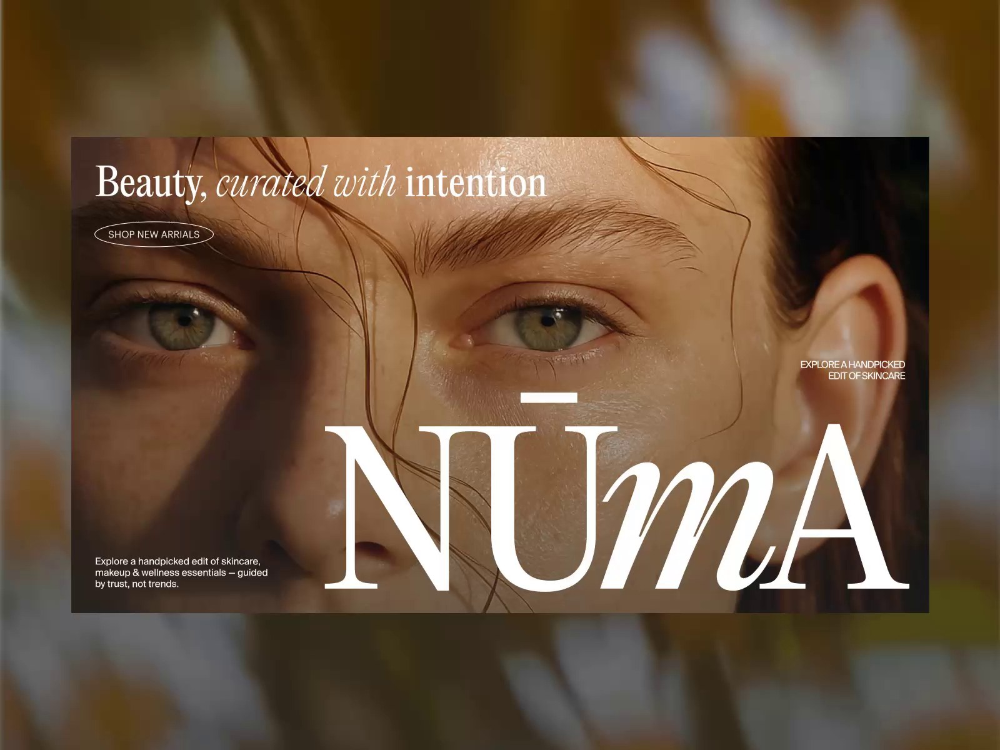
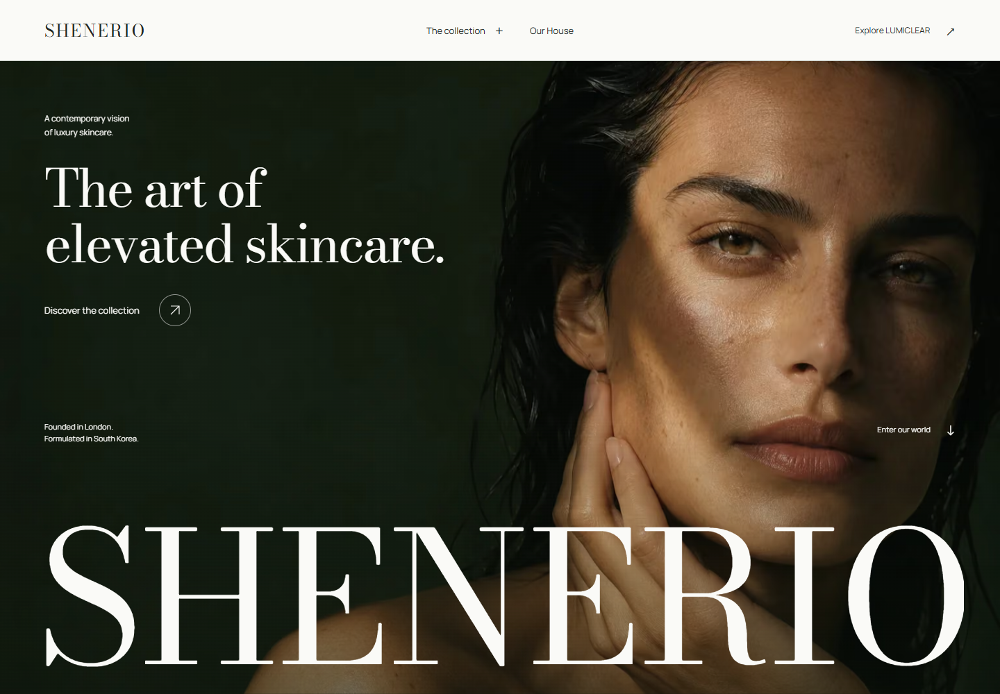
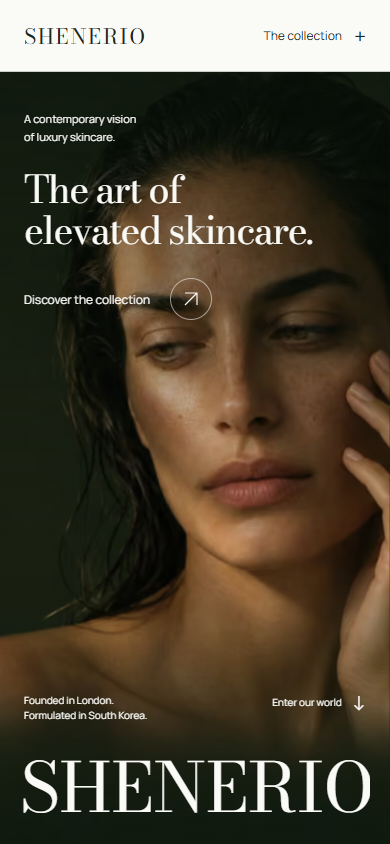
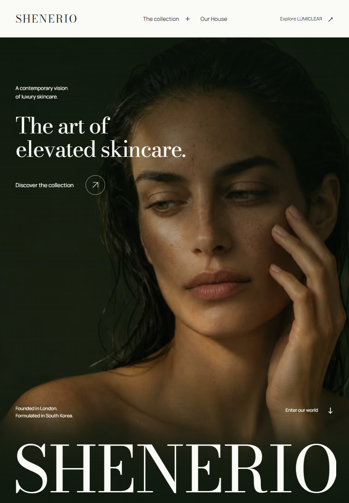

# SHENERIO reference versus Phase A / B1 prototype

Status: functional local prototype, not a complete storefront or a claim of superiority. Revisited all four saved transition strips before implementation. Numbering matches the user's confirmed Nuvé / Glowskin home / Glowskin PDP / NŪMA sequence. Original sources and timestamped analysis remain in [video breakdown](SHENERIO_VIDEO_REFERENCE_BREAKDOWN.md).

## Inspect and exercise

Run `npm ci`, `npm run build`, `npm start`; open `http://127.0.0.1:3000`. Click The collection, open either product, switch the full/detail image view, expand ingredient and ritual information, switch to the companion product, close with Escape. Follow the hero collection/House anchors. Scroll normally to see the campaign aperture and House image movement on desktop. Emulate reduced motion to see the same content without the choreography. All of these are actual browser interactions; screenshots only document their results.

The scope is deliberately header → campaign → House → two-product LUMICLEAR presentation, plus a product-preview interaction study. Not full PDPs, supporting pages or live commerce. The typeset wordmark, AI campaign imagery and packaging are concepts identified in the page and [asset register](SHENERIO_PROTOTYPE_ASSET_REGISTER.md).

## Visible reference comparisons

Frames are evidence excerpts for private review, not website artwork. These compare the recorded reference technique with an actual rendered prototype state. They are not controlled usability/performance experiments, nor exact viewport-matched replicas.

| Reference | SHENERIO browser capture |
|---|---|
| **V1 Nuvé:** immersive human subject, 00:00. [Frame](evidence/v1-000.00.jpg) | **Campaign:** original image, source headline and immediately accessible CTA. [Screenshot](prototype-evidence/desktop-hero.png) |
| **V2 Glowskin home:** expanding product navigation, 00:03–04. [Strip](evidence/video-2-transitions.jpg) | **Compact collection menu:** actual two-product discovery with explicit click/keyboard operation. [Screenshot](prototype-evidence/desktop-menu.png) |
| **V3 Glowskin PDP:** gallery/purchase relationship, 00:00–04. [Overview](evidence/video-3-sheet-1.jpg) | **Product study:** gallery full/detail controls, fixed GBP price, ingredient/ritual disclosures, modal focus containment. [Screenshot](prototype-evidence/desktop-preview.png) |
| **V4 NŪMA:** asymmetrical product rhythm, 00:08–12; editorial space, 00:02–06. [Overview](evidence/video-4-sheet-1.jpg) | **House/collection:** off-centre portrait and source story, unequal two-product stages. [House](prototype-evidence/desktop-house.png), [full page](prototype-evidence/desktop-full.png) |

### Editorial opening

| Reference composition | Actual prototype |
|---|---|
|  |  |

### Responsive composition

| Phone | Tablet |
|---|---|
|  |  |

The original videos do not show phone/tablet layouts. These captures demonstrate SHENERIO responsive work but cannot prove superiority over unobserved reference implementations.

## Adapted, improved and still below the intended standard

| Dimension | Reference technique adapted | Concrete change / implementation | Current judgment and limitation |
|---|---|---|---|
| Visual originality | V1 portrait scale + V4 brand/type confidence | New green-shadow campaign, source SHENERIO voice, original celadon/silver product concepts | Cohesive visual direction established. Hero retains the familiar luxury portrait/large-wordmark vocabulary; final distinctiveness needs approved brand artwork and art-direction review |
| Brand consistency | V4 restrained editorial system | Shared mineral palette, local Bodoni Moda/Manrope, one image/material family through campaign and products | Stronger internal coherence than borrowing V2's many pastel modules; this is a design judgment, not a measured superiority score |
| Motion sophistication | V4 type reveal, V1 editorial handoff, V2 product sequencing | CSS critical entrance begins without hydration; GSAP handles desktop scroll aperture/portrait depth and unequal product masks | Working and restrained; short bounded sequences, no complex pinned narrative. Not a claim to exceed all reference motion |
| Editorial storytelling | V4 statement/image pacing | Campaign → source House philosophy → two complementary products; change of scale/light rather than repeated cards | Clear B1 journey. The wider formulation, origin, suitability, ritual and Journal story is not yet built |
| Product presentation | V4 asymmetric retail + V3 gallery clarity | Different image-stage sizes; exact names/prices; real clickable detail view and complementary-product switch | Polished concept presentation. Detail is a crop of the same asset, not a real multi-angle product shoot; no full PDP or approved labels |
| Navigation/usability | V2 menu and V3 information panels | Click and keyboard operation, outside/Escape dismissal, labelled controls, actual modal containment/return focus, no hover-only purchase controls | Testable improvements over tiny/hover-only affordances visible in recordings. Reference keyboard behaviour is unknown; cannot assert those sites fail |
| Responsive quality | New work; reference mobile not observed | Dedicated portrait source for phone/tablet, stacked products, readable controls and reduced-motion variant | Six viewport/preference scenarios covered. Physical touch devices, iOS Safari and text-zoom inspection remain outstanding |
| Accessibility | Visual references only | Native headings/details/dialog, meaningful names, focus handling, 44px gallery controls, skip link, runtime motion preference cleanup | Automated scans and keyboard scenarios have evidence; not a full WCAG conformance audit or screen-reader certification |
| Performance | No benchmark data in recordings | Optimized local images/fonts, server-rendered content, responsive source preload, dynamic GSAP import, native scrolling | Lab evidence recorded separately; no reference field data. A controlled physical-phone performance pass is still required |
| E-commerce | V3 purchase-information hierarchy | Read-only product preview; accurate £26/£36 presentation; no fake purchase flow | Intentionally below full storefront scope. No checkout/account/inventory/basket; later phases remain essential |

## Signature interactions actually implemented

1. **Campaign reveal:** local CSS masks bring in two headline lines and the wordmark, with a small image settle. It begins before React hydration and respects reduced motion. CTA/header remain usable.
2. **Campaign-to-House aperture:** desktop native scrolling contracts the campaign frame while the following House portrait moves in a bounded, overscanned window. GSAP ScrollTrigger owns the scroll properties. There is no wheel hijack or page pinning.
3. **LUMICLEAR choreography:** unequal product stages enter with clipped image reveals. Hover/focus supplies a subtle image scale; an explicit button opens a real product dialog with a smooth full/detail crop and ingredient/ritual disclosure. Changing products transitions between original product assets.

Under reduced motion, critical content is static, scroll choreography is removed and image transitions are instant. Phone retains the entrance and product presentation but omits desktop parallax/aperture motion.

## Refinement log — the first design was not declared finished

| Finding in actual inspection | Revision |
|---|---|
| Menu images looked soft at desktop render size | Increased intrinsic image source and set responsive sizes |
| Hero's landscape image cropped too tightly on phone; same pose repeated in House | Generated a separate companion portrait; phone/tablet use portrait source; House uses the companion frame |
| Scrolled House image exposed a blank strip | Added sufficient image overscan and reduced travel; inspected updated render |
| Modal Tab sequence could reach browser chrome | Added explicit first/last focus wrapping; tested 15 sequential Tab presses and Escape/focus return |
| Initial critical animation waited for hydration; throttled LCP was ~4.06 seconds | Moved critical entrance to CSS, preloaded responsive campaign and local fonts, kept GSAP for later scroll sequences. Before/after lab artifacts retained |
| Portrait tablet still used landscape crop | Extended dedicated portrait source to widths below 1024px |

## Ten-question creative critique

1. **More sophisticated than references?** A credible, coherent interpretation, but superiority is unproven. Reference strengths remain visible beside real prototype captures.
2. **Memorable hero?** Strong scale, image and typographic presence; approved SHENERIO campaign/logo will determine final ownability.
3. **Original layouts?** House offset and paired product proportions avoid repeated generic sections; not a completely new web interaction grammar.
4. **Distinctive choreography?** A connected small set of effects, not disconnected demonstrations. More ambitious film/3D/pins have not been commissioned.
5. **Coherent transitions?** Dark campaign → light House → mineral product stages; scroll remains natural. Further sections still need art direction.
6. **Luxury typography?** Deliberate display/UI contrast with local licensed font files. Final type/logo approval remains open.
7. **Exceptional product presentation?** Strong concept materials and imagery, but real pack photography, label accuracy and multiple angles are still missing.
8. **Phone quality?** Dedicated composition, source crop and stacked rhythm; verified browser viewports, not a physical-device certification.
9. **Functional/accessibile/smooth?** Covered interactions are functional and have repeatable tests. Full screen-reader, Safari, text-zoom and real-device performance checks remain.
10. **Standout luxury flagship?** This is a persuasive opening slice and a concrete reviewable direction. It is not yet the complete flagship, and claiming otherwise would overstate B1.

See [QA report](SHENERIO_PROTOTYPE_QA.md) for measured results and current limits. The next decision is review of this prototype and approved imagery, before expanding beyond B1.
